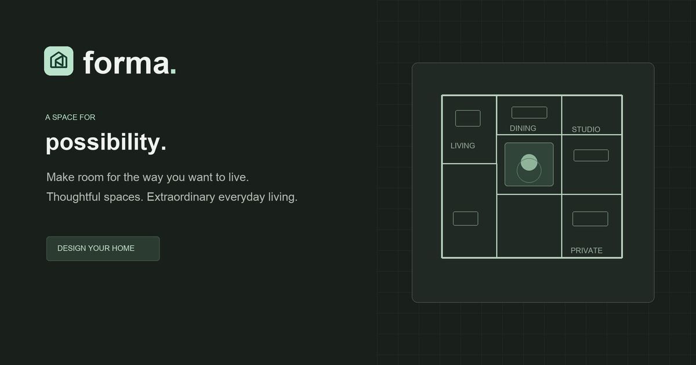

# Forma

A dependency-free, browser-based concept studio for contemporary homes. Resize rooms, place doors and windows, and explore floor plans in 2D and 3D. No account needed.

**[Open Forma](https://alphadyn.github.io/apps/forma/)** · [Local preview](http://localhost:8000/forma/)

[](https://alphadyn.github.io/apps/forma/)

Serve the repository and open the local preview, or launch Forma from the portfolio.

## Desktop and mobile workspace

- Desktop keeps the canvas alongside an independently scrolling properties inspector. Tablet and smaller windows use a dismissible navigation drawer, which supports Escape, keyboard focus containment, and tapping outside to close.
- On phones, the overview is compact and the canvas uses the available viewport height. Select a room or site item, then tap **Properties** to edit it; **Back to canvas** returns to the drawing without losing the selection. Wider windows restore the side-by-side inspector automatically.
- Touch-sized tool, zoom, navigation, and form controls support dragging rooms/site items and orbiting 3D views with one finger. Use **Pan canvas** to pan and the **+ / -** buttons to zoom. Scroll the page outside the drawing; the canvas reserves touch gestures for editing. Native browser page zoom remains available.
- Forms use readable input sizes on phones, dialogs scroll within the screen, and controls respect display safe areas. Resize-triggered drawing updates are coalesced to one per animation frame.

## Sharing in text messages

Share **https://alphadyn.github.io/apps/forma/** in SMS, iMessage, or other messaging apps. The page includes static Open Graph and large-image card metadata, an absolute HTTPS preview-image URL, and a canonical URL so crawlers can build a preview without running the editor.

The preview describes the app, not your current design. Projects stay in your browser; export a `.forma.json` file to share an editable design. The preview image is an illustration, not a screenshot of a saved project.

Metadata changes appear on the public URL after deployment. Messaging apps and recipients' devices may cache earlier previews, and plain SMS or clients with link previews disabled may show only the URL. The preview-image version can be bumped when the image changes; it does not force clients to refresh a cached page preview.

## Designing

- Begin with the furnished two-floor Courtyard House concept, or start a blank home through **Project settings → Start a new, blank project**.
- Add 17 types of spaces: bedrooms, bathrooms, kitchens, living and dining rooms, staircases, offices, utility rooms, terraces, hallways, closets, pantries, laundries, garages, entries/foyers, storage rooms, and balconies. Hallways and closets are directly available in the sidebar; **Browse all spaces** or **Add a space** opens the full library.
- Select rooms to edit names, dimensions, positions, and floor finishes. Drag rooms in 2D with half-meter snapping.
- The space inspector groups **Add to this space**, editable room properties, and **Walls & corners**. **Update space** updates the draft room properties; the top-bar **Apply changes** saves the full draft in this browser. Keyboard guidance stays collapsed until needed. Selecting an opening shows its width, height, and wall offset with an **Edit specifications** action.
- In 2D, drag a selected room's square wall handles to expand or contract perpendicular to the wall, or its round corner handles to reshape it. Movement snaps to 0.1 meters; focus a handle and use arrow keys for 0.1-meter adjustments, or Shift+arrow for 0.5 meters (also when displaying imperial units). The opposite wall stays fixed and the room's dimensions and origin update automatically.
- **Keep right angles** is on by default. Rectangular rooms stay rectangular when dragging walls or corners or adjusting them with arrow keys; corner resizing moves both adjoining walls and fixes the opposite corner. Whole-room movement leaves the shape unchanged. Turn this option off for free-form corner reshaping. Existing nonrectangular outlines remain freely editable. In shared mode, affected rectangular neighbors also stay rectangular, so moving a partial shared edge can shift their entire adjoining wall.
- Enable **Adjust adjoining rooms** in **Space properties** to also reshape touching rooms on the active floor. Partial shared edges gain matching corners at junctions; disconnected rooms and other floors are unchanged. This option is off by default, so existing single-room editing remains available.
- Add or remove corners for custom outlines of up to 12 corners. Rectangular wall resizing retains door/window specifications when they still fit. Remove specifications before making a host room nonrectangular. Invalid edits (including too-small rooms, crossing walls, excess corners, or openings that no longer fit) are rejected with an error; invalid drags roll back the entire gesture. Each valid drag is one undoable edit and stays pending until **Apply changes**.
- Add up to eight floors, switch floors, and remove floors with undo support.
- Explore the active floor in 2D or an axonometric 3D concept view with partial-height walls, material-specific floor detailing, and room-appropriate illustrative furniture.
- Pan, zoom, fit the plan, and toggle dimensions, furniture, labels, and the grid.
- Undo and redo up to 60 project edits. Shortcuts are available at the bottom of the workspace.
- Design edits stay pending until **Apply changes**; **Revert** discards everything since the last apply. Reloading also discards pending changes after a confirmation.
- Settings include the project name, design language (project metadata), and ceiling height (reflected in the axonometric wall study).
- Choose metric or imperial units in **Project settings**. Dimensions, areas, drawings, schedules, and editable measurements follow the selected units; project files continue to store measurements in meters.

## Sample home designs

Open **Sample designs** in the sidebar (inside the navigation menu on mobile), or **Project settings → Browse sample home designs**. The gallery includes fourteen independent, editable concepts:

| Design | Total floor area | Bedrooms | Bathrooms | Floors | Design approach |
| --- | ---: | ---: | ---: | ---: | --- |
| The Pocket Retreat | 80 m² | 1 | 1 | 1 | Compact minimalist home with a garden deck |
| The Garden Bungalow | 150 m² | 2 | 1 | 1 | Single-level plan with a central hall |
| The Courtyard House | 205 m² | 3 | 2 | 2 | Original compact family-home concept |
| The Terrace Townhouse | 252 m² | 3 | 3 | 3 | Narrow-lot home with a balcony and roof terrace |
| The L-Shaped Residence | 248 m² | 3 | 2 | 1 | Separate social/private wings framing a terrace |
| The Family Pavilion | 450 m² | 4 | 4 | 2 | Double garage, guest suite, and stepped upper floor |
| The Urban Duplex | 240 m² | 3 | 3 | 2 | Compact single-family two-storey home with a laundry |
| The Garden Duplex | 364 m² | 4 | 4 | 2 | Guest bedroom, garage, garden terrace, and upper balcony |
| The Palm Maisonette | 176 m² | 2 | 2 | 2 | Private ground-floor entrance, garden deck, and balcony |
| The Terrace Maisonette | 288 m² | 3 | 3 | 2 | Guest bedroom, upper lounge, and L-shaped sky terrace |
| The Horizon Mansion | 720 m² | 5 | 6 | 2 | Triple garage, guest suite, and broad upper balcony |
| The Grand Courtyard Estate | 1,088 m² | 6 | 7 | 3 | U-shaped garden court, cinema, wellness studio, and roof terraces |
| The Roof Garden Family Home | 360 m² | 3 | 3 | 3 | Two living levels plus a stair-accessed, railed roof garden |
| The Skyline Family House | 511 m² | 4 | 4 | 3 | Guest bedroom, garage, balcony, and rooftop outdoor zones |

Here, **duplex** means a single-family home across two storeys, not two separate dwellings. The maisonettes are self-contained two-level homes with private ground-floor entrances. Mansions offer larger rooms, additional suites, and dedicated leisure spaces.

Areas include terraces, balconies, stairs, and garages; they are not conditioned-area measurements. The gallery computes metrics from the same project data used in the editor.

**Explore design** opens a preview with a whole-house 3D concept, property site plan, and a cutaway of each floor. Viewing or canceling does not change the workspace. **Use this design** opens a fresh copy for editing; it replaces the current local workspace only after that confirmation. Download a backup using **Back up current design** first if needed. Undo restores the previous project until reload.

All rooms, floor finishes, floor levels, and lot settings can be edited, saved locally, exported, and reopened like any other project. Opening the same sample again starts from its original layout rather than previous edits. Existing saved projects and the original startup concept are not automatically changed.

## Doors, windows, and gates

Open **Doors, windows & gates** in the sidebar, **Doors & windows** in a selected indoor room's inspector, or **Gates & opening specifications** in the property inspector.

- Add a door or window and choose its room/floor; gates attach to a lot boundary.
- To add directly to a space, select an enclosed rectangular room on the plan or in **Rooms & spaces**, then choose **Add door** or **Add window** under **Add to this space** in the inspector. The placement editor opens with that room preselected. Choose a wall and position, adjust specifications, and save to return to the plan with the new opening selected for moving or resizing. Canceling leaves the design unchanged. Outdoor spaces and custom room outlines do not support door/window specifications.
- Custom indoor outlines keep the Add buttons visible but disabled with an explanation. If extra corners lie on an otherwise rectangular perimeter, choose **Remove extra corners** to enable the buttons without changing the room's shape, area, or position. This is an undoable edit; nonrectangular rooms are never automatically converted.
- Click an edge in the placement preview, or select north/east/south/west and enter an offset. North is the top plan edge; the street is south. Offsets run left to right on north/south walls, and top to bottom on east/west walls. Doors and windows follow their room when it moves; gates stay on the lot.
- Specify width, height, window sill height, operation/style, timber/aluminum/steel/glass material, and glazing. Door styles include hinged, sliding, double, and pivot; windows include fixed, casement, and sliding; gates include swing, sliding, and double.
- The preview updates without editing the project. **Save door/window/gate** adds the specification to the current draft and shows it on the main plan; choose **Apply changes** to persist it locally. Closing or going back without saving discards form edits.
- The specification schedule lists all features with their host, dimensions, offset, sill, style, material, and glazing. Select an entry to edit or delete it. In property views, click a specified feature (or focus it and press Enter) to reopen its editor. Dragging in 3D still orbits; only a click opens the editor.
- In the **2D floor plan**, click a specified door or window (or focus it and press Enter/Space) to select it without opening a dialog. Only the selected opening shows a center move handle and two end handles. Drag along its current wall to move it; drag either end to change the width while keeping the other end fixed. Width is shown beside the handles and the inspector shows its dimensions and offset. Choose **Edit specifications** for exact offset, width, height, sill, room, and wall settings. Press Escape or choose **Back to room** to deselect.
- Focus an opening or its handles with Tab and use arrow keys along the wall for 0.1-meter adjustments, or Shift+arrow for 0.5 meters. Pointer movement also snaps to 0.1-meter increments (including in imperial display). Openings stay on their host wall; use their specification editor to change walls or rooms. Gates and property views keep their existing specification-editor interaction.
- Moving and resizing enforce wall limits, minimum/maximum opening widths, and overlap checks, including openings on the opposite face of a shared wall. Invalid drags restore the original opening and show an error. Cancellation also restores the original; each completed valid drag is one undoable edit, pending until **Apply changes**.
- Features appear in floor plans, the ground-floor site plan, and relevant visible 3D walls. Floor cutaways show openings on the retained far walls with vertically scaled heights, matching the partial-height wall study. Whole-house views show actual specified dimensions; internal openings are not visible through closed exterior walls. Gates appear in property views, not individual floor plans.
- Rooms without specifications retain illustrative auto-generated openings. Specifying an opening replaces those decorations for that room; removing its last specification restores them. These defaults are not entries in the specification schedule.

## Architectural documentation

Open **Documentation** in the sidebar for a project-derived drawing and schedule set:

- Generate north, east, south, and west concept elevations from exterior room edges, floor heights, and specified door/window placements. Rooms without opening specifications retain the same illustrative north-facing window and south-facing door conventions as the plan.
- Generate an A–A or B–B building section. Move the cut position to inspect spaces intersected across all floors.
- Review a room schedule with level, type, area, dimensions, and floor finish, or an opening schedule with host, location, size, and specification.
- Download drawings as SVG or schedules as CSV for design discussions and further drafting.

Documentation reflects the current editable project, including floor names, room changes, and specified openings. Drawings use uniform project ceiling heights and schematic geometry; they are not construction documents, code-compliant elevations, or engineering details.
- Validation rejects overlapping openings on the same physical wall (including opposite sides of shared walls), invalid dimensions/references, spans exceeding the host edge, and openings above the ceiling. Adjust or delete specifications before shrinking a host room/lot or lowering the ceiling. Deleting a room/floor also removes its attached specifications; Undo restores both. Duplicating a room copies its space/finish, not its opening specifications.
- Specifications are included in JSON save/export/upload and visible features in SVG export. Existing saved designs without specifications remain compatible. Up to 400 specified features are supported.

These are illustrative product specifications, not certified fabrication, structural, glazing-performance, fire-safety, or security details.

### Boundary fencing

Open **House & property → Edit property → Boundary fencing** to show/hide the perimeter fence and set its height (0.5–4 m), slatted/solid style, and material. Fencing wraps all four lot boundaries in both site and 3D views, with gaps at every specified gate. It rotates with the model and is included in SVG and JSON exports.

For designs without explicit fence settings, adding a gate also shows a default 1.8 m slatted steel fence. Ungated legacy designs keep their previous unfenced appearance. An explicit disabled setting stays off even when gates are present. This is conceptual boundary treatment, not a boundary survey or certified security enclosure.

## Rooftop terraces

All 14 sample designs include curated flat-roof finishes and capped parapets. The collection demonstrates membrane, gravel, and paver roofs; timber, tile, and concrete outdoor floors; and glass, metal, and solid railings on elevated balconies and terraces. Ground-level garden terraces remain open to the garden. Gallery previews and newly opened sample copies use these settings; existing saved designs are not modified.

The two rooftop family-home samples include aligned stairs to a separate roof level, an enclosed stair/lobby, outdoor terrace zones, and example door/window/gate specifications. The Roof Garden Family Home pairs timber decks with metal railings and gravel roofs; the Skyline Family House uses tiled outdoor spaces, glass railings, and roof pavers. The roof level counts as a floor in the overview and its terrace area contributes to total floor area.

For your own design, add a floor, add **Terrace** spaces on it, and name them as rooftop zones. Add a staircase aligned with the floor below and an enclosed access room as needed. Select any terrace or balcony, enable **Show concept railing**, and choose its style and height. Choose **Update space**, then **Apply changes** to save. Railings appear on exposed outdoor edges in the plan and 3D views, rotate with the model, and are included in saved designs and SVG exports. Removing the checkbox hides the railing without discarding its style and height.

Roof access, edge protection, loading, drainage, waterproofing, staircase geometry, and structural support require professional design; the app does not certify these.

### Outdoor finishes and flat roofs

- Select a balcony or terrace and set **Floor finish** to timber decking, limestone tile, concrete, or oak. The floor cutaway and property 3D view share the same finish detailing, clipped to custom room outlines. Outdoor slab edges have an illustrative 0.18 m thickness.
- **Outdoor edge protection** offers glass panels with posts, metal balusters, or solid masonry. Height is editable from 0.6 to 1.8 m (or its equivalent in feet). Shared edges and edges against adjacent rooms are omitted, including on custom-shaped outdoor spaces. These ranges are visual modeling limits, not safety/code recommendations.
- In **Project settings**, or **House & property → Roof finish & parapets**, choose a light membrane, gravel ballast, or roof pavers. Enable exposed-edge parapets and set their height from 0.2 to 1.2 m. The finish applies to enclosed-room flat roofs throughout the house.
- Roof edges have an illustrative 0.18 m fascia. Parapets have 0.12 m thick walls, base flashing, and segmented, overhanging coping caps; gravel ballast uses varied stone sizes and tones rather than a repeating dot grid. Edge details follow exterior roof edges, omit shared interior edges, and split around upper-floor footprints so they do not pass through upper rooms or roof decks. Turn off **Show full-height walls & roofs** to hide both roofs and their edge details for the open-top study.
- Railing and parapet heights contribute to the property height and 3D framing. Controls follow the selected measurement system; saved dimensions remain in meters. Duplicating an outdoor space preserves its finish and railing settings.
- Settings participate in undo/redo, **Apply changes**/**Revert**, JSON save/open, and current-view SVG export. Existing designs without these optional settings retain their 1.1 m glass railings and membrane roofs without parapets.

## House, lot, and property

Select **House & property** in the sidebar, or **Property** above the canvas:

- **Site plan** shows the entire rectangular lot, ground-floor spaces, dashed upper-floor footprints, landscaping, driveway, street frontage, and lot dimensions.
- **3D view** assembles every floor at its actual level into one contemporary exterior concept on the lot, with shaded facades, framed glazing, a finished roof surface, and layered landscaping. Windows, roofs, deck surfaces, shadows, trees, and paving are illustrative, not construction details. Toggle **Show full-height walls & roofs** for an open-top study, or select a floor to edit its interior.
- Full-house roofs are opaque and exterior walls join at floor elevations, keeping the closed exterior solid as you rotate or tilt. Only the open-top study intentionally exposes the interior.
- **Edit property** controls lot width/depth (8–200 m), the house origin, street name, landscaping, and the driveway. These controls are also available through project settings.
- In **Property → Site plan**, drag the whole house, individual trees, or the driveway to arrange the site. Select an item and use arrow keys for 0.1 m nudges, or Shift+arrow for 0.5 m. The **Arrange your property** inspector also offers an item selector and exact X/Y positions in the selected measurement system. Use the floor buttons to edit individual rooms; the property 3D view keeps its existing orbit and floor-selection behavior.
- Site drags snap to 0.1 m and form a single undoable edit. Escape or a cancelled drag restores the starting layout; invalid moves restore it with an error. **Apply changes**, **Revert**, undo/redo, and JSON save/open include the layout. The same positions appear in 3D and current-view SVG exports.
- Moving the house changes the shared origin of all floors and their openings, not individual room coordinates or boundary gates. Trees and the driveway stay where placed. The first move stores the generated landscaping as explicit positions; older designs keep automatic landscaping until edited.
- Tree centers and canopy extents must fit inside the lot. The driveway's rear-left corner moves while its front remains connected to the street; it must fit within the lot with positive depth. House placement outside the lot remains allowed with the existing warning. Tree/building overlaps, driveway access, and setbacks are not automatically resolved. Hiding landscaping or the driveway preserves its layout; lot resizing must still contain stored tree canopies and the driveway.
- House X/Y offsets locate the common origin of every floor relative to the left/rear boundaries. Room X/Y positions stay relative to the house origin. The street is along the front/bottom boundary.
- The overview reports lot area, building footprint, site coverage, and house height. Footprint is the union of enclosed room projections across all floors, excluding terraces and balconies; overlapping spaces count once for this metric.
- Rooms extending beyond the property boundary remain visible and trigger a warning. This is not a setback, boundary survey, or zoning compliance check.
- Zoom, pan, fit, dimensions, and labels work in property views. SVG exports capture the chosen floor or whole-property view; JSON includes the lot settings.

## Rotating the 3D model

Both floor cutaways and whole-house property views support orbit rotation:

- In **3D view**, use the default select tool (**V**) and drag with a mouse or one finger to rotate horizontally and tilt vertically. The near side of the model follows the pointer: dragging right turns it right, and dragging down tilts it down. Rotation works when starting on the house or the canvas; a drag does not edit rooms or navigate to another floor.
- Use the **Rotate** and **Tilt** sliders for precise angles. Sliders also support keyboard arrow keys. Horizontal rotation wraps through 360 degrees; tilt is limited to 10–80 degrees to keep the model upright.
- A click/tap without dragging still selects a room or opens a floor for editing. Choose **Pan** (**H**) to move the canvas instead of orbiting.
- **Reset** in the 3D orbit panel restores the default 45-degree rotation, 30-degree tilt, zoom, and canvas position. **Fit to canvas** resets only zoom and pan, retaining rotation.
- The north indicator follows the camera. Exterior facades, windows, surface ordering, and the property all rotate with the model.
- The current angle is shared between floor/property views for this page session. Rotation is view state: it does not change the design or create undo entries, and it resets on reload or opening a saved design. An SVG export captures the current angle.

## Saving and export

Edits remain pending until you choose **Apply changes**, which saves the current design in this browser. **Revert** discards every change made since the last apply. Reloading the page also discards unapplied changes and prompts before leaving when a draft is pending. Undo and redo help refine pending edits; applying or reverting starts a fresh edit history. Save failures are shown in the workspace; download a JSON backup if browser storage is unavailable. **Export** downloads either the current SVG canvas view or a complete editable `.forma.json` project.

### Upload a saved design and continue

1. Select **Open design** in the top bar (the upload icon on smaller screens), or **Project settings → Open project**.
2. Choose a `.forma.json` / `.json` file, or drop one onto the upload area. Files must be at most 1 MB.
3. Review the project name, file name, floor/space counts, floor area, and lot dimensions. The current workspace is unchanged during preview or if validation fails. A backup action lets you download the current design before replacing it.
4. Select **Open & continue**. The design becomes an editable draft. Choose **Apply changes** to save it to this browser or **Revert** to return to the last applied design.

Import validates file size, identifiers, room dimensions, lot settings, and supported settings. Older projects without property settings are upgraded with a default 26 × 32 m lot without changing their floor plans. Images, SVG exports, PDFs, and external CAD files cannot be imported as editable designs.

The Forma logo reloads the locally saved workspace. No accounts or backend are required. Google Fonts provides optional typography; system sans-serif fonts are used if unavailable.

## Scope

This is a conceptual planning tool, **not construction or permit documentation**. Wall thickness, openings, furniture, and site landscaping are illustrative. Specified openings are checked for span, height, references, and mutual overlap, but the app does not check building regulations, structural safety, accessibility, circulation, general room collisions, or staircase compliance. Floor area is the sum of room outlines across all floors, including terraces and stairs; overlapping areas count separately. Work with licensed professionals before construction.

## Validation

```sh
node --test forma/model.test.js forma/space-edit.test.js forma/opening-edit.test.js forma/inspector-ui.test.js forma/property-view.test.js forma/camera.test.js forma/samples.test.js forma/architecture.test.js
```

The tests cover all space types, totals, room placement, edits, saved-design file validation, legacy import, lot validation, union footprint area, exterior wall detection, orbit projection and angle limits, surface ordering, and both 3D renderers from every viewing quadrant. Space-edit tests cover expansion and contraction, perpendicular wall movement, corner reshaping, shared and partial-wall junctions, invalid edits, opening constraints, and serialization. Opening-edit tests cover movement and resizing on every wall, fixed opposite endpoints, width and wall limits, shared-wall collisions, unit-aware controls, and saved-design round trips. Sample tests check exact metrics, lot fit, non-overlapping rooms, supported upper-floor rooms, aligned stairs, fresh-copy isolation, project round trips, and preview rendering. Architecture tests cover specification validation, shared-wall overlaps, host geometry, saved features, full-perimeter rooftop railings, boundary fences, gate cutouts, and fence visibility from every quadrant. UI can be previewed with the repository's **Preview apps portfolio** VS Code task.
